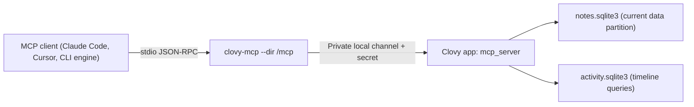

# Clovy MCP server

Local MCP clients read the
current data partition's notes, dictations, and memories, and the
installation's activity, through a stdio MCP server, `clovy-mcp`. It is on by
default (the switch in Settings → MCP turns it off, and the choice survives
restarts) and answers only while Clovy is open. Authenticated external clients
also get the applicable tools described in [Aprovações externas](#aprovações-externas).
Internal CLI consumers use a **turn binding** and get turn-bound tools in their
saved policy. Bound domain mutations
use the in-app **approval broker** and revalidate the host binding after waits.
Media generation keeps its direct-provider charging policy without an extra
broker card; Browser use input follows the same broker and its own browser guards.
Requirements: the `clovy-mcp-server` specs of the OpenSpec changes
`add-activity-intelligence` and `default-capture-and-session-mcp`, and the
`clovy-mcp-server` delta of `cli-substitui-agente-nativo` (which owns the
names of the turn-bound tools, [spec/mcp-tool-naming.md](../spec/mcp-tool-naming.md));
decision records: [ADR-0058](adr/0058-clovy-mcp-server-relays-to-the-running-app.md)
(the relay),
[ADR-0059](adr/0059-activity-is-per-installation-not-per-data-partition.md)
(activity has no partition), and
[ADR-0063](adr/0063-cli-turns-get-write-tools-through-an-approval-broker.md)
(turn binding and approval broker; `proposed` until the owner accepts the
parity proof). Terms are in
[CONTEXT.md](../CONTEXT.md#activity-capture). The flags each CLI turn gets are
in [llm-providers.md](llm-providers.md#cli-chat-engine).

The management expansion names are fixed by D3-D5 of
[melhorias-agente-audio-automacao](../openspec/changes/melhorias-agente-audio-automacao/design.md).
Bound access uses the host-owned `dataPartition` snapshot in the run's
`run_config_json`, captured atomically with `approvalMode` when the run is
created and carried by `TurnContext` and `TurnBinding`. A UI partition switch
does not change it. Moving the conversation to another partition invalidates
the old run's access; it does not redirect an issued token. A new run captures
the new association. Missing or malformed snapshots, missing conversations or
runs, and mismatched associations fail closed, including after approvals and
writer waits. Metadata updates cannot fill or replace these authority fields.
Unprofiled sessions explicitly snapshot `default`; routines use their own
persisted session origin, never the visible app view or its bypass policy.
Bound context resources and prompt dispatch revalidate the same snapshot.
External reads retain the current-view scope. Additional external tools use
the data partition captured by the host for the operation.
Projects organize data; IDs never grant access across partitions. Stop revokes
the host binding; every bound dispatch and post-approval mutation checks it.

## Where the code lives

| Path | What |
| --- | --- |
| `src-tauri/src/mcp_server/mod.rs` | Switch, listener lifecycle, Tauri commands, configuration snippets, per-message data access |
| `src-tauri/src/mcp_server/channel.rs`, `channel/` | Shared handshake/quotas/revocation, Unix socket or private Windows named pipe, installation secret and client I/O |
| `src-tauri/src/mcp_server/stdio.rs` | The `clovy-mcp` relay (and its answers while the app is unreachable) |
| `src-tauri/src/mcp_server/protocol.rs` | MCP JSON-RPC: lifecycle, `tools/*`, `resources/*`, `clovy://context`, `clovy://guide`, MCP content blocks |
| `src-tauri/src/mcp_server/turns.rs` | Turn registry: issue, bind, revoke turn tokens (`turn_required`, `turn_expired`) |
| `src-tauri/src/mcp_server/tools/mod.rs` | `ToolGroup`, `ToolCtx`, the group registry, `tools/list` and `tools/call` dispatch |
| `src-tauri/src/mcp_server/tools/read.rs` | The read tools every client gets, and their limits |
| `src-tauri/src/mcp_server/tools/` | One file per turn-bound group (`notes`, `memory`, `media`, `recorder`, `browser`, `computer_use`, `vault_skills`, `routines`, `connectors`, `gateway`, `interaction`), each with its `*_tests.rs` |
| `src-tauri/src/approval_broker/` | Aprovações de turno e fila externa com prazo, decisão única, cancelamento e invalidação |
| `src-tauri/src/chat_engine/policy.rs` | The flags each CLI turn gets (safety mode, attended, tool timeout) |
| `src-tauri/src/bin/clovy_mcp.rs` | Binary entry point |
| `src-tauri/bundle-clovy-mcp.sh` | macOS `beforeBundleCommand` step: copies and signs the binary into `.tauri-helper/` |
| `scripts/prepare-windows-mcp.mjs` | Builds the Cargo-reported Windows relay, signs it and stages its source/target/profile/digest manifest for the installer |
| `src/components/settings/McpServerSection.tsx`, `src/components/settings/McpExternalApprovals.tsx`, `src/lib/mcp-server.ts` | Configurações MCP, pedidos de aprovação externa e bindings |

Tests: `cargo test mcp_server` (protocol against test databases, the relay
through a real socket, refusal without the secret, connection and request
limits, JSON-RPC validation, oversized lines, calendar context across
daylight-saving changes, serialized settings updates, coding-agent blocks, day
panels and schedule, turn binding and revocation (`turn_tests.rs`), and one
`tools/<group>_tests.rs` per turn-bound group with a test broker),
`cargo test approval_broker`, `src-tauri/tests/mcp_server_stdio.rs` (the built
`clovy-mcp` binary spawned over stdio against the app side served in the test
process, including the debug build's refusal of production data, a bound turn
until revocation, and image content blocks),
`src-tauri/tests/mcp_server_doc_catalog.rs` (the tool tables of this document
against `tools/list` for an unbound client and each kind of turn, and its
links and code paths), `src/test/mcp-server-section.test.tsx`,
`src/test/cli-approval-cards.test.tsx` (approval and clarification cards of
CLI turns), and `src/test/mcp-server-dev-runner.test.ts` (the development
runner builds the relay).

## Shape

The binary never opens a database: the activity key lives only in the
Keychain for the app, and the capture thread owns the activity store. It
relays each line to the app, which answers with the same queries, exclusions,
and retention as the agent tools and the "Today" view.

## Local channel

- macOS uses the Unix socket below. Windows uses a duplex byte-mode local
  named pipe, `\\.\pipe\clovy-mcp-<SHA256 of canonical installation directory>`.
  `--dir` still identifies the installation, never an arbitrary pipe address.
  Remote clients are rejected, and every instance has an explicit protected
  user/SYSTEM DACL. The first instance reserves the name; renewal keeps an
  instance alive while creating its replacement. Both peers qualify the real
  process TokenUser through a retained process handle, failing closed when it
  cannot be queried. The relay is a child of the CLI, not of Clovy, so no
  parent-PID rule applies. The secret and turn token remain mandatory.
- Windows creates the MCP directory and secret with a protected private ACL
  from the start. Existing objects must have the current owner and a private
  protected ACL; inherited/ambiguous ACLs, reparse ancestors and hard-linked
  secrets are refused. Ancestor handles prevent rename/delete during access.
  No ancestor ACL, existing secret or client configuration is rewritten.
  The debug relay protects the same Roaming AppData release directory Tauri
  resolves, while the dev app keeps its separate `-dev` directory.
- Directory `<app data dir>/mcp/` (mode 0700): `clovy.sock` (Unix socket, mode
  0600) and `secret` (64 hex characters, mode 0600, created the first time the
  server starts and kept across restarts: the installation secret).
- The listener runs only while the switch is on; turning it off closes every
  connection and removes the socket. A socket left by a crash is replaced on the
  next start.
- Handshake: the client's first line is `{"clovyMcp": 1, "secret": "<hex>"}`,
  plus `"turn": "<token>"` when the relay was started with `--turn` (see
  [Turn binding](#turn-binding)). The app checks the peer's user id (same user
  only) and compares the secret in constant time, then the turn token if any,
  and answers `{"clovyMcp": 1, "ok": true}`, or
  `{"clovyMcp": 1, "ok": false, "error": "unauthorized"}` (or `"busy"`, see
  limits, or `"turn_expired"`) and closes.
- After `ok`: newline-delimited MCP JSON-RPC messages in both directions, at
  most 4 MiB per line; requests run concurrently and answers may arrive out of
  order (matched by `id`).
- Limits (any process of the same user can reach the socket; `channel.rs`):
  - at most 4 connections waiting for their handshake (5 s each); more are
    closed as soon as they are accepted, before any read;
  - at most 8 authenticated connections; the next gets `"busy"`;
  - at most 4 requests of one connection being answered at once; the app
    applies backpressure to bound turns. For authenticated external connections,
    an additional request gets a busy error. The relay keeps reading to detect
    cancellation or disconnect while all four requests wait for approval;
  - persistent `accept` errors (out of descriptors) back off 100 ms.
- Unix socket paths are limited to 104 bytes on macOS; a data dir deeper than
  that makes the server fail to start with the error shown in Settings.
- Server handshake reading and writing are bounded by 5 s and observe
  shutdown. Windows client authentication has one total 5 s deadline. The
  relay keeps one I/O runtime per process across reconnects, with concurrent
  read/write halves. Native pending writes are explicitly cancelled on abort;
  Tokio/Mio retains OVERLAPPED storage until completion. Graceful pipe close
  uses a zero-byte write as a native-write completion barrier, under the common
  drain deadline; it never calls blocking `FlushFileBuffers`. These details
  rely on the locked Tokio 1.52.3 / Mio 1.2.1 implementations.
- O relay externo informa ao host o fim da entrada stdio antes de drenar as
  respostas. O host revoga pedidos pendentes também no named pipe do Windows,
  que mantém a conexão aberta por um curto período para entregar recibos.

## Turn binding

A CLI chat turn with Clovy's server (Claude Code, Codex, Copilot) issues a
**turn token** in the app's turn registry (`mcp_server::turns::TurnRegistry`,
one per app, kept across turning the server off and on) before the CLI starts.
The token (32 random bytes, 64 hex characters) is bound to the session, run,
CLI, safety mode, whether a person watches the turn (`attended`: chat `true`,
routines `false`), and the surface (`chat` or `routine`).

- The relay gets it as `--turn <token>` in the server arguments
  (`McpLaunch::for_turn`): Claude Code and Copilot in the temporary MCP
  configuration file, Codex in `-c mcp_servers.clovy.args`. It never goes into
  the prompt or the environment. It is visible to same-user processes in
  `ps`, which can already read the installation secret, and it opens nothing
  without that secret.
- The handshake carries it as the additive `turn` field; the protocol
  version stays `1`. `turn` absent or `null` is an external connection after
  local authentication; an
  unknown or revoked token, or a value that is not a string, gets
  `"error": "turn_expired"`. The token is checked only after the secret and
  the user id. An older relay without `--turn`, or an older app that ignores
  `turn`, gives an unbound connection.
- A token serves every connection of the run (the relay reconnects) and is
  never reused by another run. It is revoked when the turn ends, fails, or is
  cancelled (`chat_engine::turn::TurnGrant`, and `cancel_cli_run` before the
  process is stopped), and on app shutdown (`revoke_all` in
  `shutdown::run_cleanup`). A revoked connection reads no new request,
  delivers the answers of the calls in flight for at most 2 s, then closes;
  a call still unanswered then, and every later call, gets
  `... (turn_expired)` from the relay.
- Revocation stops new admissions immediately. An in-flight handler may still
  report a correlated delivery receipt during that grace period; if its result
  is unknown, the response does not claim the action was safely undelivered.
- A connection lost after writing a tool request yields a correlated
  `mcp_delivery_unknown` result (`delivery: unknown`, `effect: unknown`,
  `retrySafe: false`, original `callId`) when no real receipt arrived. The
  relay never resends that request, including after a partial write. A later
  independent request can reconnect. EOF alone does not prove turn expiry.
- An unbound connection never sees a turn-bound tool in `tools/list`, and
  calling one returns an `isError` result ending in `(turn_required)` without
  running it.

## Approval broker

Each run derives its approval mode from the session's runtime mode when the
run is created: `unrestricted` snapshots `bypass`, and `sandboxed` snapshots
`approvals`. There is no separate approval control or setter command. The
legacy session `approval_mode` column is retained without authority, so even a
legacy `bypass` value in a sandboxed conversation requires approval. Retries
capture the current runtime mode through the same run-creation path.

For attended runs, bypass authorizes Clovy tool approval requests, while
clarifications still require a person. Unattended turns always require approval
and cannot inherit bypass. Connector grants, authentication and operating-system
permissions remain independent. Automatic authorizations are recorded before
the tool may continue, with `authorizationOrigin: "session_bypass"`; one-shot
decisions have `authorizationOrigin: "user_once"`. Both identify the policy run.
Codex in `unrestricted` separately uses `danger-full-access`, including routines
explicitly configured with that mode; the broker still refuses unattended write
requests. See [LLM providers](llm-providers.md#cli-chat-engine).
For a bound turn, `clovy://context` includes the host-bound session and run,
engine, surface, data partition, project assignments, workspace and execution
and approval policies. An external client receives temporal context only.

Every turn-bound tool that writes asks the approval broker
(`crate::approval_broker`) before any effect. The broker writes an
`interruption` item in the bound session (the same item the legacy Clovy
agent used, with `engine: "cli"` and `cli`; title and description come from
the tool's code, never from the model), moves the run to
`waiting_for_user`, emits `interruption.requested`, and waits for the
decision. The existing approval and clarification cards render it; the
answer goes through `resolve_agent_interruption`, which hands CLI items to
the broker. `once` approves this call only (stored as `resolution: "once"`);
`deny` denies. The unsupported `session` and `always` choices are rejected
without settling the request. One decision is accepted;
a second or late answer gets `agent_interruption_expired`.

| Outcome | Tool error (`isError`, `message (code)`) | Item |
| --- | --- | --- |
| Approved | none: the tool runs and returns its result | `resolved`, `resolution: "once"` |
| Denied | `user_denied` | `resolved`, `resolution: "deny"` |
| No answer in 10 minutes (`APPROVAL_TIMEOUT`) | `approval_timed_out` | `expired`, `retiredReason: "timeout"` |
| Run cancelled, ended, or app closing | `run_cancelled` | `cancelled`, `retiredReason: "cancelled"` (`"restarted"` when found pending at startup) |
| Unattended turn (routine) | `unattended_requires_approval` | none: no card |
| Storage or broker unavailable | `approval_unavailable` | none: the tool does not run |

`APPROVAL_TIMEOUT` (10 minutes, fixed) is shorter than the tool timeout each
CLI turn gets (15 minutes, `chat_engine::policy::CLI_TOOL_TIMEOUT`, checked at
compile time). A clarification (`request_clarification`) is the same item
with `kind: "clarification"`, `question`, and `choices`; the answer is the
tool's result.
Browser use asks this same broker for every click, fill and key press. Its session
controls manage takeover, resume and Stop; they do not issue approvals.

### Aprovações externas

O host atribui uma identidade à conexão externa após o handshake autenticado.
As consultas existentes continuam disponíveis com os mesmos parâmetros e filtros.
Sem uma identidade externa validada, somente as ferramentas de leitura originais
estão disponíveis. IDs de sessão, turno ou workspace fornecidos pelo cliente
jamais concedem autoridade interna.

A barra lateral indica pedidos pendentes. Em Configurações → MCP, cada pedido
mostra a ferramenta, o conjunto de dados e a prévia da operação e do alvo. A
decisão autoriza uma chamada exata, ou a nega. O cliente recebe o resultado da
ferramenta pela mesma conexão. O prazo máximo é de 10 minutos. Desconexão,
cancelamento, desativação do servidor ou perda do conjunto de dados invalidam o
pedido. O host revalida autoridade e alvo antes do efeito. O perfil ativo desta
versão é `default`.

Além das consultas originais, o catálogo externo inclui `get_dictation`,
`list_notes`, `list_projects`, `get_project`, `list_routines` e
`list_routine_runs`. `search_memories` depende da configuração de memória.
`list_skills` e `load_skill` dependem de um diretório gerenciado de skills.
Resultados externos omitem os IDs internos de conversa e de turno e os caminhos
locais de projetos e skills. A disponibilidade das ferramentas de Atividade
depende do suporte a suas configurações na instalação.

Os handlers externos podem criar, editar e excluir notas, memórias e projetos,
vincular e desvincular notas de projetos, apagar ditados retidos e atualizar ou
pausar a captura de Atividade quando aplicável. Cada mudança exige aprovação.
Prévia grande demais para exibir por inteiro impede a solicitação. Os handlers
aplicam as regras de retenção, escopo, configuração de memória e revisões de
nota. Ferramentas de conector, mídia, Browser use, Computer use e controle de
gravação que exigem autoridade interna permanecem sujeitas ao contexto de
seus próprios handlers.

O shell lista pedidos por `mcp_external_approvals`, decide por
`mcp_external_approval_decide` e atualiza o conteúdo no evento
`mcp-external-approvals-changed`. O evento carrega apenas a invalidação.

## The relay while Clovy is unreachable

`clovy-mcp` answers by itself so the client sees why: `initialize` and `ping`
succeed (the instructions carry the reason), `tools/call` returns an
`isError` result with the reason, other requests fail with JSON-RPC error
`-32000`. Reasons: never turned on (no secret yet), off or Clovy not open (no
socket or nobody listening), secret refused, every connection slot busy, or
Clovy closed the connection mid-request (pending requests get that error).
Each message retries the connection, so turning the server on (or opening
Clovy) needs no client restart.

The relay also validates its input before anything reaches the app: a stdin
line longer than 4 MiB is skipped to its newline without being kept and
answered with `-32600` (id `null`); a line that is not JSON gets `-32700`; an
object that is not a valid JSON-RPC 2.0 request or notification (no or
non-string `method`, `jsonrpc` other than `"2.0"`, an id that is not a string
or number, a batch array) gets `-32600` with its id when usable. The app
applies the same validation to messages it receives. Notifications and
responses sent by the client get no answer.

**Debug builds and production data.** A debug `clovy-mcp` refuses a `--dir`
under the installed app's data directory
(`~/Library/Application Support/dev.guilhermexp.clovy`), answering every
message with that reason, unless `OS_CLOVY_USE_PROD_DATA_DIR` is set (the same
opt-in the debug app honors). Development snippets point at the `-dev` data
directory.

## Tools and resources

Names are fixed in the `clovy-mcp-server` specs (the read tools) and in the
`clovy-mcp-server` delta of `cli-substitui-agente-nativo` (the turn-bound
tools). `src-tauri/tests/mcp_server_doc_catalog.rs` compares the tables below
with `tools/list`. Notes, dictations, and memories are limited to the current
data partition; activity tools read the installation's activity, whichever
partition is open ([ADR-0059](adr/0059-activity-is-per-installation-not-per-data-partition.md)).
Activity tools are listed only while activity capture is on and refuse with
`activity_capture_off` otherwise; they apply the current app and domain
exclusions and the retention period like the agent tools
([activity-timeline.md](activity-timeline.md)). Tool failures come back as
`isError` results with `message (code)`. `structuredContent.error` preserves
the code, message and available details. Delivery/retry details also appear in
a second text block so a client cannot lose `retrySafe: false` when a completed
effect outlives turn revalidation.

### Tools for every client

Unbound clients and attended chat turns get these read-only tools
(`readOnlyHint`). Routine turns also require a saved routine with an enabled
context toolset (`context_engine`, `memory`, or `session_search`). Missing or
revoked routine authorization hides these reads and denies their calls.

| Tool | Arguments | Result and limits |
| --- | --- | --- |
| `search_notes` | `query`, `limit` (1-20, default 10) | Notes whose title, text, or an authoritative transcript contains `query`: id, title, snippet around the match, `matchedIn`, matching `transcriptId`, dates |
| `get_note` | `id`, `contentOffset`, `transcriptOffset` | Title, text in pages of 20,000 characters and authoritative transcripts in pages of 40,000 characters; offsets count characters. |
| `list_note_transcripts` | `id`, `offset`, `textOffset`, `limit` | Authoritative transcripts across sessions/sources and legacy records, with identity, status, error, creation and timing; continuation offsets include long text. Replaced aggregates are excluded by session/source identity, never text deduplication. Generation shares the same selection. |
| `list_dictations` | `query`, `limit` (1-50, default 20), `offset` | Dictations of the last 7 days, newest first, text up to 4,000 characters each, `hasMore`/`nextOffset` |
| `list_memories` | `projectId`, `includeGlobal`, `limit` (1-20, default 8), `offset` | Same as the agent tool; refuses while memory is off (globally or for the project) |
| `get_activity_timeline` | `from`, `to` | Complete session and gap records overlapping `[from, to)`; stats count time clipped to that interval. Active state is materialized by the activity ETL, approximately every 30 seconds. At most 300 sessions/gaps; see `truncated`. |
| `search_activity` | `query`, `from`, `to`, `limit` (1-50) | The agent tool: moments, app, window, URL, snippet |
| `get_activity_stats` | `from`, `to` | Focused, idle, away minutes, top 5 apps, minutes per category |
| `get_active_session` | none | The session in progress and the ongoing gap (looking back 12 hours); `lastSession` when nothing is active |
| `list_app_usage` | `from`, `to`, `limit` (1-100, default 20) | Minutes and session count per app, most used first, `totalApps`, `truncated` |
| `get_session_detail` | `id` | Session, its windows and URLs (windows on excluded domains dropped, and the text excerpt with them), text excerpt; sessions excluded or past retention are "not found" |
| `list_coding_agent_sessions` | `from`, `to`, `limit` (1-50, default 20) | Coding-agent blocks overlapping the period ([coding-agent-sessions.md](coding-agent-sessions.md)), newest first: id, agent, source, session id, project, title, start and end, `activeMinutes`, prompts, replies, state, summary (else `firstPrompt`); only sources turned on in Settings, Activity and blocks within the retention period; never the transcript or the working directory; `totalBlocks`, `truncated` |
| `get_day_summary` | `date` (optional local `YYYY-MM-DD`, default today) | Day summary (headline, narrative, insights, standup: done, inProgress, blockers, hoursCovered, locale, provider, trigger, generatedAt), workstreams (each hour with `periods` `[{startedAt, endedAt}]`, the bounds of the measured sessions its work was located in, not its duration, or null when only the hour is known, and `locatedMinutes`, the minutes those periods cover), and hour reports (each activity with its `periods`, same shape, or null); `summary: null` with `state: "not_generated"` when none exists yet; respects retention |
| `get_day_panels` | `date` (optional local `YYYY-MM-DD`, default today) | The summary's panels as the "Today" view draws them (`pipeline::day_view`, [day-intelligence.md](day-intelligence.md)), recomputed at each call: `focusedMinutes`, `idleMinutes`, `awayMinutes`, `topApps`, `categories`, `hours` (`[{hour: "YYYY-MM-DDTHH", focusedMinutes}]`, every local hour of the day), `workstreams` (`[{id, title, minutes}]`, 20 at most, `totalWorkstreams`, `truncated`), `meetings` (`count`, `minutes` of the recorded notes of the open data partition), `codingAgents` (`blocks`, `activeMinutes` of the sources turned on, prorated to the day); activity and blocks before the retention floor are left out, and a date before it answers `state: "past_retention"` with `panels: null` |
| `get_day_schedule` | none | `summaryTime` (local `HH:MM` the day summary is written), `notifications` (`enabled`, `quietHours`: `enabled`, `start`, `end`) from Settings, Activity |

### Tools for turn-bound connections

The table describes the available catalog before saved routine restrictions.
Routine context reads need an enabled context toolset; active skill discovery
and loading need `skills`, routine history needs `routines`. Skill administration
requires an attended turn. Missing or revoked routine authorization hides tools
and denies calls; configuration does not create grants. Enabled toolsets never
make an unattended mutation self-authorizing.

This table describes visibility on connections bound to a turn. The separate
external catalog reuses applicable handlers listed under
[Aprovações externas](#aprovações-externas). "Listed to" says
which turns see the tool: `every turn`, `attended turns` (chat; never
routines), or `Claude turns`. A `Claude turns` tool is listed for Claude Code
itself, not for the model: every Claude turn with Clovy's server, attended or
not, gets `--disallowedTools mcp__clovy__<tool>` (`chat_engine::policy`). "Broker" says what the call asks first: `yes`
(an approval request governed by the run's effective policy), `clarification` (a question card), `conditional`
(the central broker for browser input actions), or `no`. In an
unattended turn every `yes` and `clarification` answers
`unattended_requires_approval` without a card.

| Tool | Group | Listed to | Broker | Arguments and result |
| --- | --- | --- | --- | --- |
| `get_dictation` | notes | every turn | no | `id`, `textOffset`: one retained dictation (same 7-day floor as `list_dictations`) in pages of 40,000 characters (`textTotalChars`, `nextTextOffset`) |
| `list_notes` | notes | every turn | no | Page notes in the bound partition; optional `projectId`, `limit`, `cursor`. |
| `create_note` | notes | every turn | yes | Create a note with optional `projectId`. |
| `update_note` | notes | every turn | yes | Update title or content with mandatory `expectedRevision`. |
| `delete_note` | notes | every turn | yes | Delete a note and its recording files. |
| `list_conversations` | conversations | every turn | no | Page conversation metadata in the bound partition. |
| `get_conversation` | conversations | every turn | no | Read conversation metadata by `conversationId`. |
| `get_conversation_run` | conversations | every turn | no | Read a run by `conversationId` and `runId`. |
| `list_conversation_messages` | conversations | every turn | no | Page user and assistant text by run, sequence and ID; `nextCursor` and `nextTextOffset` continue the result. |
| `search_conversation_messages` | conversations | every turn | no | Search and page user and assistant text in one conversation. |
| `list_conversation_artifacts` | conversations | every turn | no | Page artifact metadata by `conversationId`; paths are not exposed. |
| `read_conversation_artifact` | conversations | every turn | no | Read bounded UTF-8 text by conversation and artifact ID; offsets count bytes and binary content is rejected. |
| `create_conversation` | conversations | every turn | yes | Create a conversation in the bound partition without starting a run. |
| `rename_conversation` | conversations | every turn | yes | Rename a conversation. |
| `archive_conversation` | conversations | every turn | yes | Mark a conversation completed. |
| `restore_conversation` | conversations | every turn | yes | Remove the completed marker. |
| `delete_conversation` | conversations | every turn | yes | Delete a conversation only while it has no active run; self-deletion is refused. |
| `cancel_conversation_run` | conversations | every turn | yes | Exact `conversationId` and `runId`; cancel another run through its own session, never the caller's run. |
| `list_projects` | projects | every turn | no | Page bound projects with `offset` and `limit`. |
| `get_project` | projects | every turn | no | `projectId`: fields, association counts and notes. |
| `create_project` | projects | every turn | yes | `name`, optional `description`, `instructions` (4,000 characters), `memoryDisabled`. |
| `update_project` | projects | every turn | yes | `projectId` and compound fields applied in one transaction. |
| `delete_project` | projects | every turn | yes | `projectId`, explicit `deleteNotes`; approval previews affected IDs/counts and a changed preview fails before deletion. Clean up associated memory, links and selected note audio; preserve conversations. |
| `assign_note_project` | projects | every turn | yes | `projectId`, `noteId`: add an association, preserving others. |
| `remove_note_project` | projects | every turn | yes | `projectId`, `noteId`: remove only that association. |
| `assign_conversation_project` | projects | every turn | yes | `projectId`, `conversationId`: both must exist in the bound partition. |
| `remove_conversation_project` | projects | every turn | yes | `projectId`, `conversationId`: preserve the conversation and other associations. |
| `save_memory` | memory | every turn | yes | `content` (up to 4,000 characters), `projectId`: saves one memory (`source: "agent"`); refuses while memory is off globally or for the project, checked again after approval |
| `forget_memory` | memory | every turn | yes | `id`: forgets one memory (with its tombstone); same gates |
| `update_memory` | memory | every turn | yes | `id`, `content`; settings-locked update preserves ID, source, creation and project scope. |
| `search_memories` | memory | every turn | no | `query`, `projectId`, `includeGlobal`, `offset`, `limit`; scope and disabled/deleted projects filtered before paging. |
| `list_routines` | routines | every turn | no | none: routines and their schedules |
| `create_routine` | routines | every turn | yes | `name`, `prompt`, `schedule`, IANA `timezone`, CLI `model`, `enabledToolsets`, `safetyMode`; normal CLI/provider usage can incur cost. Configuration creates no grants. |
| `update_routine` | routines | every turn | yes | `routineId` and supported configuration fields; same validation and no implicit grants. |
| `pause_routine` | routines | every turn | yes | `routineId` |
| `resume_routine` | routines | every turn | yes | `routineId` |
| `delete_routine` | routines | every turn | yes | `routineId`: deletes it permanently |
| `run_routine` | routines | every turn | yes | `routineId`: start through the real single-flight scheduler; report started/busy/blocked, not success for an unclaimed run. |
| `list_routine_runs` | routines | every turn | no | Optional `routineId`, `offset`, `limit`; deterministic persisted run history. |
| `get_obsidian_vault` | vault and skills | every turn | no | none: the selected Obsidian vault; discovery never authorizes writes (the CLI reads the files itself) |
| `list_skills` | vault and skills | every turn | no | none: the globally enabled Clovy skills (`agent_skill_settings`) |
| `load_skill` | vault and skills | every turn | no | `name`: instructions of one globally enabled skill; a disabled one is refused |
| `list_skill_settings` | vault and skills | attended turns | no | Active, disabled and unavailable skill metadata, canonical identity, source and editability; effective `enabled`, saved/default `configuredEnabled`, `readable`, typed `error`. |
| `read_skill` | vault and skills | attended turns | no | `name`: inspect content, including disabled skills, without executing it. |
| `update_skill` | vault and skills | attended turns | yes | `name`, `content` up to 512 KiB; managed root only, atomic replacement anchored to the selected directory handle. Global skills stay read-only. |
| `enable_skill` | vault and skills | attended turns | yes | `name`: enable the canonical skill identity. |
| `disable_skill` | vault and skills | attended turns | yes | `name`: disable it without deleting files or backups. |
| `get_activity_settings` | activity | every turn | no | Installation settings/status; available even with capture off, no activation. |
| `update_activity_settings` | activity | every turn | yes | Closed editable settings DTO; preserve internal MCP/default fields under the native settings lock. |
| `pause_activity` | activity | every turn | yes | Pause installation capture without rebuilding history. |
| `resume_activity` | activity | every turn | yes | Resume through the existing activity service. |
| `generate_day_summary` | activity | every turn | yes | Required local `day` (`YYYY-MM-DD`); real configured-provider generation, preserving empty-data, database and pending-hour/provider errors and normal usage cost. |
| `delete_dictation` | dictation | every turn | yes | `id`: deletion qualified by the bound partition. |
| `start_dictation` | dictation | every turn | yes | Pin host take/composer/window destination, await real listening confirmation; transcription/cleanup use configured providers and may incur charges. |
| `get_dictation_status` | dictation | every turn | no | Real correlated take/helper status; no start or permission effect. |
| `stop_dictation` | dictation | every turn | yes | `takeId`: finalize and deliver once to the previously fixed composer, never a free target app. |
| `cancel_dictation` | dictation | every turn | yes | `takeId`: discard that take and refuse late delivery. |
| `start_session` | browser | attended or routine turns | no | none: returns `sessionId`, integer `tabId`, effective mode |
| `close_session` | browser | attended or routine turns | no | `session_id`: ends control, retains dedicated logins |
| `navigate` | browser | attended or routine turns | no | `session_id`, integer `tab_id`, `url` |
| `snapshot` | browser | attended or routine turns | no | `session_id`, integer `tab_id`: page data and opaque refs |
| `screenshot` | browser | attended or routine turns | no | `session_id`, integer `tab_id`: redacted PNG image plus receipt |
| `click` | browser | attended or routine turns | conditional | `session_id`, integer `tab_id`, `ref` |
| `fill` | browser | attended or routine turns | conditional | `session_id`, integer `tab_id`, `ref`, `text` |
| `press` | browser | attended or routine turns | conditional | `session_id`, integer `tab_id`, `ref`, `key` |
| `back` | browser | attended or routine turns | no | `session_id`, integer `tab_id` |
| `list_tabs` | browser | attended or routine turns | no | `session_id` |
| `open_tab` | browser | attended or routine turns | no | `session_id`, `url` (optional) |
| `switch_tab` | browser | attended or routine turns | no | `session_id`, integer `tab_id` |
| `close_tab` | browser | attended or routine turns | no | `session_id`, integer `tab_id` |
| `computer_use` | computer use | attended turns | conditional | `action` (`capture`, `list_apps`, `wait`, `open_app`, `focus_app`, `click`, `double_click`, `right_click`, `drag`, `scroll`, `type`, `key`, `set_value`) and its arguments: the turn's effective approval policy applies; the turn binding opens the run's lease; the capture comes back as an `image` block |
| `generate_image` | media | every turn | no | `prompt`: calls fal directly with the user's key; the file goes to `artifacts/` of the bound session's workspace and `agent_artifacts`, and comes back as an `image` block while under 3 MiB |
| `edit_image` | media | every turn | no | `sourcePath` (relative to the session workspace or absolute), `instruction`: sandboxed turns require the canonical source to remain inside the workspace; same storage |
| `generate_video` | media | every turn | no | `prompt`, `duration`, `aspectRatio`, `audio`, `jobId` (resumes a job): polls within the CLI's tool timeout; same storage |
| `start_recording` | recorder | every turn | yes | `sourceMode` (`microphoneOnly`, `microphonePlusSystem`): the frontend starts the visible recording (ADR-0013) after approval |
| `stop_recording` | recorder | every turn | yes | none: stops the visible recording |
| `recording_status` | recorder | every turn | no | none: whether Clovy is recording, with its metadata |
| `pause_recording` | recorder | every turn | yes | Exact active `sessionId`; pause the real visible recorder. |
| `resume_recording` | recorder | every turn | yes | Exact paused `sessionId`; resume the same note/session. |
| `recover_recording` | recorder | every turn | yes | `sessionId`, `action` (`validate`, `discard`); preserve source, note and session correlation. |
| `retry_note_processing` | recorder | every turn | yes | `noteId`, `sessionId`; real durable retry through the main-window bridge; normal provider usage may be charged. |
| `list_recording_artifacts` | recorder | every turn | no | `sessionId`: artifact IDs, sources, status and duration without filesystem paths. |
| `request_clarification` | interaction | every turn | clarification | `question`, `choices`: the user's answer is the result |
| `approve_action` | interaction | Claude turns | yes | `tool_name`, `input`, `tool_use_id`: Claude Code's `--permission-prompt-tool`; answers `{"behavior":"allow","updatedInput":...}` or `{"behavior":"deny","message":...}`; kept from the model by `--disallowedTools` in every Claude turn |

Browser use requires a host-bound conversation/run. A routine must additionally
resolve to its persisted routine run and hold a current dedicated browsing
grant; it receives an anonymous profile and cannot click, fill or press keys.
Attended input actions use the central approval broker regardless of page labels,
then revalidate the owner and exact element identity. Passwords, verification
codes and payment details require human takeover in the dedicated browser;
capture and input remain paused until explicit resume. Stop and turn-token
revocation terminate startup and the entire process tree without waiting for
wire/CDP or approval locks. Dispatched actions with lost responses return
`browser_outcome_unknown` without retry. `computer_use` remains attended-only.

Skill administration isolates invalid, oversized or unreadable entries. They
remain inspectable with `error: {code,message}` but do not enter the active
catalog or chat-start selection. Explicit reading reports the typed failure;
replacing a managed skill can repair it without enabling it. Canonical settings
take precedence over legacy alias rows. Global storage remains read-only during
startup seeding, legacy promotion and administration, including canonical-root
aliases. Hidden entries and objective `.bak`, `.old` or `~` backups are excluded;
legitimate names such as `foo-backup` remain discoverable.

### Connector tools

Listed to a bound turn per connected account with the scope each tool needs
(Gmail and Calendar share the Google account), and Notion's per its hosted
server's inventory, filtered by the allowlist. The catalog is cached per turn
for 15 s and is never an authorization: the account's scopes are checked
again at each call, after the approval for mutations. Tokens stay in the
app. A mutation denied by the user makes no request to the provider. A
connector that cannot be discovered drops its tools from the list without
failing `tools/list`.

| Tool | Connector | Broker |
| --- | --- | --- |
| `search_threads` | Gmail | no |
| `read_thread` | Gmail | no |
| `list_unread` | Gmail | no |
| `create_draft` | Gmail | yes |
| `send_email` | Gmail | yes |
| `modify_labels` | Gmail | yes |
| `archive` | Gmail | yes |
| `list_events` | Calendar | no |
| `get_event` | Calendar | no |
| `find_free_slots` | Calendar | no |
| `create_event` | Calendar | yes |
| `respond_to_invite` | Calendar | yes |
| `list_repositories` | GitHub | no |
| `get_pull_request` | GitHub | no |
| `search_issues` | GitHub | no |
| `get_issue` | GitHub | no |
| `list_issue_comments` | GitHub | no |
| `create_issue` | GitHub | yes |
| `update_issue` | GitHub | yes |
| `add_comment` | GitHub | yes |
| `notion-search` | Notion | no |
| `notion-fetch` | Notion | no |
| `notion-query-data-sources` | Notion | no |
| `notion-query-database-view` | Notion | no |
| `notion-get-comments` | Notion | no |
| `notion-get-enhanced-markdown-specification` | Notion | no |
| `notion-get-view-configuration-dsl` | Notion | no |
| `notion-create-pages` | Notion | yes |
| `notion-update-page` | Notion | yes |

Notion actions are bound to the broker's approval id (in place of the legacy
digest by run and call id). Notion names are the hosted server's, not ours
([spec/mcp-tool-naming.md](../spec/mcp-tool-naming.md), exceptions).

### MCP gateway (user servers and Linear)

A bound turn also lists the enabled tools of the user's MCP servers
(`mcp_<server>_<tool>`) and of the managed Linear server (`mcp_linear_*`),
discovered per turn through `agent_mcp` with its visibility rules, timeouts,
output limit, and Seatbelt for stdio servers in a `sandboxed` session. A tool
the server's policy marks as needing approval (the default for user servers;
Linear by its annotations) asks the broker first. An elicitation from the
server becomes a clarification card. Headers, environment, and OAuth tokens
stay in the Keychain and the app's memory, never in the CLI's argv,
environment, or files. A server that cannot be discovered drops its tools
from the list without failing `tools/list`.

Vercel's official Streamable HTTP endpoint is `https://mcp.vercel.com`.
Its protected-resource metadata identifies `https://vercel.com` as the
authorization server and advertises `openid`; the authorization server also
advertises `offline_access`, but a refresh grant depends on the actual consent
and provider response. Vercel requires clients to be reviewed and approved:
support for the protocol and approval of a different client do not establish
approval of Clovy. A live connection therefore requires Vercel's acceptance
of Clovy's own client and the user's consent. See the [Vercel MCP client
review requirements](https://vercel.com/docs/agent-resources/vercel-mcp#connecting-to-vercel-mcp).
The Vercel preset starts disabled and requires approval for its tools. The
host reports credential cleanup separately from remote revocation; if local
cleanup fails, the disabled server retains a pending cleanup state for retry.
Tool calls are not automatically repeated after a 401 or transport failure,
because delivery of a mutation can be uncertain. A connection configured by a
CLI is a separate origin with its own credentials and permissions.

For the exact official Vercel resource, Clovy reads authorization metadata
from `https://mcp.vercel.com/.well-known/oauth-authorization-server` and
requires issuer `https://vercel.com`, HTTPS and the official authorization,
token, registration and revocation endpoints. This is a host-owned resource
profile, not a configurable discovery override. The issuer's own metadata at
`https://vercel.com/.well-known/oauth-authorization-server` describes a
different login contract: it advertises only `web_message.opener` and uses
`api.vercel.com` token endpoints. Clovy does not fall back to that document.
The MCP document omits response modes; the OAuth metadata default includes
query, which Clovy explicitly requests. An explicit response-mode list must
include query. These metadata checks establish protocol compatibility, not
provider acceptance or proof of a live loopback authorization. See
[RFC 8414 section 2](https://www.rfc-editor.org/rfc/rfc8414.html#section-2).

Connect owns an operation id so cancellation can be latched before repository
startup and a late cancellation cannot cancel a later connection. A whole-flow
deadline covers metadata, registration, callback, code exchange and bounded,
validated paged tool discovery. Reconnect advances the stored policy revision
before opening the browser; existing approval receipts do not authorize the new
connection. Before writing a new credential, SQLite records its pending
reference. A crash before or after the secure-store write is recovered from
that journal on list, reconnect or disconnect. Failed deletion keeps the
reference and prevents reuse. Remote revocation failure survives restart and
remains distinct from local cleanup. Settings never accept pasted OAuth
identity/tokens, and changes to HTTP headers preserve the host-owned grant;
changing its URL or transport requires disconnect first.
OAuth transport uses the active grant for `Authorization`; a manual header
with that name is removed on conversion and rejected for OAuth configurations.
Invalid OAuth header updates are rejected before disconnecting or revoking the
existing grant, and validated again after acquiring the lifecycle gate.
Other configured headers and manual-credential servers keep their own rules.

If a refresh returns rotated credentials after cancellation/disconnect, or the
new credentials cannot be saved, the host tries to revoke that actual rotated
grant before discarding it. An unconfirmed result is journaled and survives
restart; a provider's idempotent acceptance of an older token's revocation does
not clear that warning. A successful revocation response means the provider
accepted the request, not independent proof about an entire token family.
Disabling or deleting a locally cleared server reports remote revocation
separately. Delete returns `{localDeleted, remoteRevoked}` and the UI keeps a
provider-action warning when local removal succeeds but revocation remains
unconfirmed. Failed local secure-store cleanup retains the disabled row for
retry, rather than dropping its credential reference.

Settings Test uses the same compensated refresh path as dispatch. Disconnect
records the remote outcome in SQLite before deleting the local grant, so a
failed cleanup commit or restart cannot erase an observed revocation failure.
Before a refresh request can consume a token, SQLite records conservative
rotation uncertainty. Saving the received grant or confirming its compensation
restores only the previous warning state; an interrupted request keeps the
warning across restart.
A custom HTTP server may explicitly switch back to manual headers after a
complete OAuth teardown. Live grants, pending cleanup and unresolved remote
warnings block that switch; the official Vercel preset keeps OAuth. Saving a
name or configuration edit retains the backend's effective diagnostic.

The managed registry retains each discovery or refresh failure without removing
healthy servers. Settings and relay errors carry origin, server, optional tool,
actual phase, typed code, optional numeric remote code, state and recovery
action. The relay serializes only this safe diagnostic shape. CLI-owned MCP
errors identify their observed server/tool and separate custody; this is not a
complete inventory of inherited CLI connections. Tool-call errors with uncertain
delivery preserve that uncertainty and never cause automatic redispatch.

An unresolved revocation belongs to its affected credential reference and
revision. Successful reconnect preserves that warning in host-owned history
while activating a separately authorized grant. Settings shows the historical
warning independently of the current connection's health, so successful Test,
discovery, save or restart cannot erase it. A warning about an earlier grant
does not make a valid new primary credential unusable. Revoking the new token
does not discharge the earlier obligation.
Grant generation stays stable when reconnect changes the policy revision.
The previous primary's credentials remain in historical custody after a valid
replacement. Clovy does not automatically revoke that token during reconnect,
because it cannot assume independent token families; revocation can invalidate
related tokens under [RFC 7009](https://www.rfc-editor.org/rfc/rfc7009#section-2.1).
Explicit Disconnect or Delete reconciles those saved grants. Confirmation for
one saved superseded token clears only its matching obligation, never an older
unknown rotation or exchange associated with the same reference.

Connect reserves an operation-owned credential reference before authorization.
Admission is serialized before publishing the new operation identity or
invalidating previous authority. A rejected overlapping Connect leaves the
running operation's epoch, identity and useful diagnostic intact. Explicit
Cancel, Disconnect and Delete retain their cancellation boundaries.
Before the actual code-exchange request, its journal records that a grant may
be issued. The returned bundle enters the reserved secure-store reference
before catalog discovery awaits; this temporary custody does not enable the
connection. Only valid catalog, epoch and configuration checks can activate
that reference. Cancellation, timeout and rejected activation compensate the
actual received bundle, or retain its recoverable reference and an honest
warning. An exchange with an unknown outcome cannot be reported as remotely
revoked merely because the previous primary token's revocation returned 200.
Recovery distinguishes live operations, possible issuance and stored candidate
credentials; it never blindly deletes a received grant. Delete retains the
definition while live issuance or recoverable candidate custody still needs
cleanup. Failed attempts preserve the previous primary configuration.

A persisted attempt phase alone does not prove that its process owner is still
alive. After restart, a temporary credential-store failure can leave an
authorizing, exchange-pending or received attempt awaiting recovery. Settings
keeps the storage diagnostic and offers Disconnect to retry cleanup without
new authorization or deleting the configuration. It does not report an unknown
exchange as remotely revoked. During an active Connect, the current local
operation continues to expose correlated Cancel and the existing busy controls;
rendering this metadata adds no cleanup or authorization request. Existing host
recovery remains responsible for reconciling the interrupted attempt.

Custom dispatch also checks the host configuration fingerprint and the epoch
captured during discovery, so an earlier approval cannot adopt a replacement
endpoint, credential or local safety policy between gateway check and I/O.
The host-owned revocation warnings, historical records and temporary Connect
bookkeeping are excluded from that authority fingerprint. The credential loader
checks uncertainty affecting the current primary under the lifecycle gate before
permitting use; auth mode, cleanup state, revision and local policy still bind
the authority snapshot.
The custom authority follows initialization, session waits and elicitation to
the transport write boundary. Invalidation before dispatch sends no tool call;
an already admitted call or lost elicitation session remains delivery-uncertain
and is never replayed. Cancellation or a later approval failure does not erase
that uncertainty; the same rule applies when a managed Linear connection is
lost before resuming an elicitation. The final chat error string retains the safe numeric
remote code. OAuth callback errors retain only allowlisted provider codes:
denied consent, client approval and provider failure remain distinct, while
unknown codes and free-form descriptions are sanitized.

### Content blocks

A tool result is one `text` block with the result as JSON, except
`computer_use`, `screenshot`, and the image tools, which return MCP content
blocks (`protocol::content_value`): images as `image` blocks (up to 3 MiB in
base64; a larger one stays in Clovy) and the rest as `text`.

### Times and resources

Activity times are RFC 3339 with offset; omitted bounds mean today so far. `get_day_summary` and `get_day_panels` take a local date `YYYY-MM-DD` (default today).

`get_day_summary` preserva os `minutes` existentes e expõe `seconds` nas
atividades, frentes e horas de cada frente, além de `locatedSeconds` nas horas.
`get_day_panels` também inclui `seconds` nas frentes. Esses campos mantêm o
tempo exato: três atividades de 40 s somam 120 s, mesmo que cada `minutes`
arredondado seja 1. Dados antigos sem segundos usam `minutes * 60` (ou
`locatedMinutes * 60` para o tempo localizado); zero explícito não usa fallback.

Sessions and gaps leave out the app's `bundleId` and the gap's `id`: the
"Today" view uses them only for app icons and list keys, and no tool takes a
gap id.

Resources: `clovy://context` (JSON: `now`, `date`, `time`, `weekday`,
`timeZone` (IANA name from `TZ` or `/etc/localtime`), `utcOffset`,
`yesterday`, `startOfToday`) and `clovy://guide` (Markdown: which tool answers
which question, dates, limits, privacy). `yesterday` is the previous local
date and `startOfToday` the first local moment of today with the offset in
force then (midnight, or the first minute after a daylight-saving jump that
skips it), not "now minus 24 hours" or now's offset.

## Configuration for clients

`mcp_server_status` returns the snippets the Settings section copies; they all
run the bundled binary with the channel directory:

- Command: `<Clovy.app>/Contents/Resources/native/bin/clovy-mcp` (development
  builds: next to the app executable in `src-tauri/target/<profile>/`;
  `scripts/cargo-clovy-runner.sh` builds it with the app on every
  `pnpm tauri:dev`).
- Args: `["--dir", "<app data dir>/mcp"]`. No environment variables.
- Claude Code: `claude mcp add --scope user clovy -- <command> --dir '<dir>'`,
  or `{"mcpServers": {"clovy": {"type": "stdio", "command": ..., "args": [...]}}}`
  in `.mcp.json` / `--mcp-config`.
- Cursor: the same object without `type` in `~/.cursor/mcp.json`.

Moving Clovy.app changes the command path; copy the configuration again.

### For child processes (CLI chat engines)

`crate::mcp_server::child_process_launch(&app)` returns the `McpLaunch`
(`command`, `args`; no env) or `mcp_server_binary_missing`;
`crate::mcp_server::claude_code_config(&launch)` builds the `mcpServers` object
to write to a temporary file for `claude --mcp-config <file>` or translate
for another CLI. `McpLaunch::for_turn(token)` adds `["--turn", token]` for a
turn-bound connection ([Turn binding](#turn-binding)). The server must be on
for its tools to answer; otherwise the child gets the relay's "off" errors.

## Storage of the switch

`mcpServer` in `activity-settings.json` (default `true`; profiles saved before
it became default-on are turned on once, see the defaults upgrade in
[activity-capture.md](activity-capture.md#settings-activity-settingsjson-app-config-dir)).
Only `mcp_server_set_enabled` changes it; `activity_save_settings` keeps the
stored value so a stale Activity tab cannot flip it. Both go through
`ActivityShared::update_settings`, which holds one lock across reading the
latest settings, writing the file, and publishing them, so an Activity save
and an MCP toggle at the same moment never undo each other. A save whose
write fails returns `activity_settings_save_failed` and changes nothing. App
setup schedules the listener start when the switch is on
(`McpServerState::apply_switch`), whether or not capture is on or has its
permissions; activity tools are offered only while capture is on. Nothing
waits for the listener: CLI chat engines get the launch whenever the switch is
on, and tools and resources answer once the listener is ready. A request that
arrives earlier gets the relay's own answer: `initialize` and `ping` succeed
locally, `tools/call` returns an error result, and other requests (such as
`tools/list` and `resources/*`) fail, both with the unreachable reason. The
relay opens a new connection for a later request when it has none, so
requests after the listener is ready reach the app. macOS and Windows with
activity settings available are supported; other platforms hide this section.
On Windows the resolver prefers `native/bin/clovy-mcp.exe`, then the relay
beside the dev executable. The copied shell command targets PowerShell (single
quotes inside an argument are doubled); JSON command/args stay structured.

Windows release preparation always invokes Cargo with the requested target,
profile and `CARGO_TARGET_DIR`, selects its executable event, signs the relay
with the configured publisher and stages it with a source/digest manifest.
Bootstrap creates only the resource directory. Final NSIS verification requires
one relay and manifest under `native/bin`, compares extracted/staged hashes,
checks current-source provenance and requires the same Authenticode publisher
as the host and installer. No certificate is provisioned by these scripts.

Transport-only proof: `mcp_server::channel::transport_tests` and
`tests/mcp_transport_stdio.rs` exercise real local I/O and the relay executable
without desktop/CLI credentials. Windows-only cases cover storage, real peer
token qualification, handshake deadlines and cancellation; the reparse fixture
is ignored unless the host already permits symlinks. GNU typechecking does not
prove Windows ACL enforcement, another SID, remote refusal, Authenticode, NSIS
extraction or live Claude/Codex turns. Those require a native Windows run.
